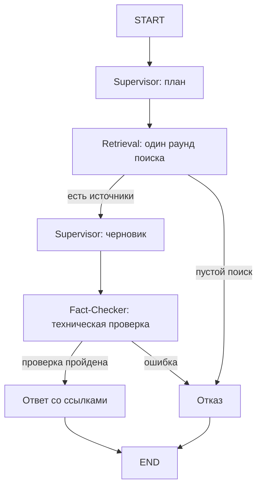

# Intem: прототип КП2

Intem — прототип мультиагентной системы для ответов на вопросы по нормативным документам НИЯУ МИФИ. На этапе КП2 реализованы базовый граф агентов, поиск по документам и демонстрация маршрутизации запроса.

Прототип служит основой для дальнейшего развития проекта. Следующие этапы предусматривают смысловую проверку ответов, рефлексию, память диалога и автоматическую оценку качества. Эти возможности пока не реализованы.

## Документация

- [Полное объяснение системы и технологий](docs/SYSTEM_EXPLANATION.md) — что реализовано в КП2, как проходит запрос, как устроены агенты, поиск, модель и проверка цитат.
- [Распределение работы участников](docs/OWNERSHIP.md).
- [Граф LangGraph в формате Mermaid](docs/graph.mmd).
- [Примеры фактических маршрутов в режиме demo](docs/demo-routing.json).

## Что можно показать

Supervisor разбивает вопрос на поисковые запросы. Retrieval один раз выбирает поисковые инструменты и собирает фрагменты. Supervisor формирует ответ, после чего Fact-Checker проверяет наличие источников, подлинность цитат и номера ссылок. Граф направляет результат в ответ или отказ. Если поиск пустой, граф сразу возвращает отказ.



Работает только один проход, без повторного поиска и исправления ответа. Поле `trace` показывает сообщения между агентами, `timings` — фактическую последовательность узлов. Логи возвращаются в ответе на запрос, история диалога не сохраняется.

## Запуск

Нужен Python 3.11 или новее. Выполняйте команды из корня репозитория:

```bash
python3 -m venv .venv
.venv/bin/pip install -r requirements.lock
.venv/bin/pip install --no-deps -e '.[dev]'
cp .env.example .env
.venv/bin/python -m intem.cli index-core
.venv/bin/uvicorn intem.api:api --host 127.0.0.1 --port 8001
```

Открой <http://127.0.0.1:8001/docs>. В `POST /ask` нажми **Try it out**, введи вопрос и нажми **Execute**:

```json
{"question": "Каковы основания отчисления за академическую задолженность?"}
```

API запускается локально на порту 8001. Авторизация пока не реализована. Для взаимодействия доступны CLI и Swagger; корень `/` перенаправляет в Swagger.

## Проверка маршрутизации

```bash
.venv/bin/python -m intem.cli graph
.venv/bin/python -m intem.cli ask "Как ликвидируется академическая задолженность?" --json
.venv/bin/python -m intem.cli ask "Сколько стоит полёт на Марс?" --json
.venv/bin/python -m pytest -q
```

В первом ответе проверяй `timings` и `trace`: при найденных и принятых цитатах маршрут `plan → retrieve → draft → check → answer`. Для вопроса вне корпуса ожидается `plan → retrieve → refuse`. Если источники нашлись, но цитаты не прошли проверку, будет `plan → retrieve → draft → check → refuse`, без цикла исправления.

Для демонстрации графа без внешней модели:

```bash
INTEM_MODE=demo .venv/bin/python -m intem.cli ask "Как ликвидируется академическая задолженность?" --json
```

Режим `demo` возвращает дословные выдержки по лексическому совпадению. Он нужен для проверки исполнения графа и не заменяет LLM-анализ.

## Модель и данные

По умолчанию `.env.example` включает режим `demo`: ключ и сеть не нужны. Для LLM-режима укажи в локальном `.env` значение `INTEM_MODE=llm`, свой `INTEM_LLM_API_KEY`, совместимый API URL и модель. В примере заданы GenAPI и `gpt-5-nano`. Не публикуй `.env`: он исключён через `.gitignore`. Внешние переменные `INTEM_*` имеют приоритет над `.env`.

Команды выполняй из корня репозитория: пути к корпусу и `var/intem.sqlite3` относительные. Локальная база не входит в репозиторий и создаётся командой `index-core`. Корпус содержит 4 PDF; текущая индексация даёт 220 фрагментов. Для прототипа используются локальные хеш-векторы и поиск по словам, это не полноценные семантические embeddings. ChromaDB не используется.

Документы из официального каталога МИФИ:

- Правила внутреннего распорядка обучающихся.
- Положение о кредитно-модульной системе.
- Положение о промежуточной аттестации.
- Положение о порядке перевода, восстановления и отчисления.

URL источников, контрольные суммы и сведения о загрузке находятся в `data/mephi/manifest.json`. Номера страниц сохраняются в индексе при обработке PDF. Расширение корпуса документами о приёме и стипендиях, OCR и автоматическое скачивание пока не реализованы. При первом запуске индекс нужно построить из четырёх PDF (эта команда также приведена в инструкции запуска):

```bash
.venv/bin/python -m intem.cli index-core
```

Если меняешь модель embeddings, удали только локальную базу прототипа и заново выполни `index-core`, чтобы не смешивать несовместимые векторы.

## Ограничения КП2

Проверка цитат подтверждает существование источника и совпадение текста. Она **не доказывает смысловую корректность вывода**, применимость нормы и полноту ответа. В LLM-ответе есть соответствующая пометка. Нет независимой смысловой проверки, рефлексии, долговременной памяти, профилей, LLM-as-a-Judge, автоматических метрик, Red Teaming, веб-клиента и интернет-туннеля.

Для устойчивой работы реализованы таймауты, обработка ошибок API и валидация формата. Сетевой протокол Google A2A не реализован: узлы общаются через общее состояние LangGraph.

Распределение кода и задач следующего этапа: [OWNERSHIP.md](docs/OWNERSHIP.md).

## Состав репозитория

Публикуются исходники `intem/`, тесты `tests/`, документация `docs/`, четыре PDF и их манифест в `data/mephi/`, `pyproject.toml`, `requirements.lock`, `.env.example` и `.gitignore`.

Локальные ключи, SQLite-база, виртуальное окружение, кэши и результаты сборки исключены через `.gitignore`. PDF — сторонние документы НИЯУ МИФИ; источники и контрольные суммы указаны в манифесте. Их наличие в корпусе не означает передачу прав на документы.
