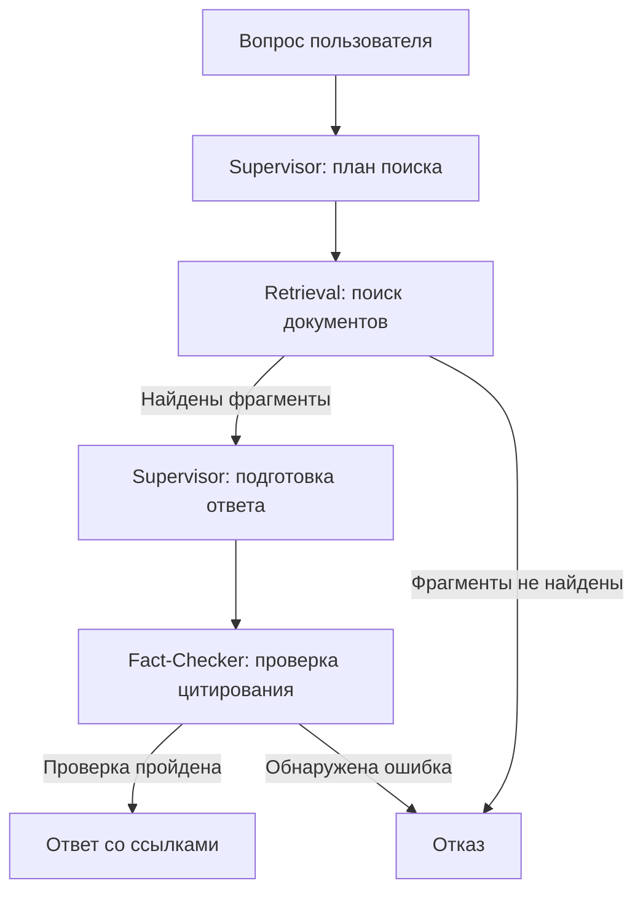

# КП2: полное объяснение системы и технологий

В КП2 сделана **отдельная рабочая версия проекта, которая демонстрирует базовый граф агентов и маршрутизацию запроса**. Она оформлена как самостоятельный проект.

Прототип принимает вопрос, ищет сведения в документах МИФИ, формирует ответ со ссылками и проверяет корректность цитирования. Если подходящих источников нет или проверка не пройдена, возвращает отказ.

Дальше — полное объяснение именно этой версии.

## Что изменилось по сравнению с основным проектом

Система сокращена до возможностей, необходимых для демонстрации КП2:

| Компонент | Что осталось в КП2 |
|---|---|
| Supervisor | Разбиение вопроса на запросы, подготовка ответа |
| Retrieval | Один раунд поиска по документам |
| Fact-Checker | Техническая проверка источников, цитат и ссылок |
| LangGraph | Управление последовательностью действий и ветвлением |
| База документов | Четыре основных документа МИФИ, 220 фрагментов |
| Интерфейс | Командная строка и API со Swagger |
| Рефлексия | Убрана: повторного поиска и исправления ответа нет |
| Память | Убрана: профиль и история диалога не сохраняются |
| LLM-as-a-Judge | Не подключён |
| Готовый сайт | Убран |

Поэтому версия КП2 проще основного проекта: она показывает, что компоненты соединены и запрос действительно проходит по разным веткам графа.

## Какую задачу решает система

Обычный запрос к языковой модели может дать правдоподобный ответ, который не соответствует правилам конкретного университета.

В нашем проекте ответ должен опираться на загруженные документы МИФИ. Для этого используется подход **RAG — Retrieval-Augmented Generation**, то есть генерация ответа с предварительным поиском информации.

Работа разделяется на две части:

1. Программа находит подходящие фрагменты документов.
2. Языковая модель получает эти фрагменты вместе с вопросом и составляет ответ.

При этом мы **не обучаем модель на документах** и не изменяем её параметры. Мы передаём найденные выдержки в контекст конкретного запроса.

Агентная часть добавляет распределение ролей: один компонент планирует, другой выбирает инструмент поиска, третий проверяет результат.

## Как проходит запрос

Допустим, пользователь спрашивает:

> «Сколько незачётов можно получить, чтобы не отчислили?»

Запрос проходит по следующему графу:



Здесь есть три возможных маршрута:

```text
plan → retrieve → draft → check → answer
```

Найдены источники, подготовлен ответ, цитирование прошло проверку.

```text
plan → retrieve → refuse
```

Поиск не нашёл подходящих фрагментов.

```text
plan → retrieve → draft → check → refuse
```

Источники нашлись, но подготовленный ответ не прошёл техническую проверку.

В КП2 нет перехода обратно к поиску или генерации. Каждый этап выполняется один раз.

Код графа находится в [graph.py](../intem/graph.py).

## Supervisor: планирование и подготовка ответа

Supervisor отвечает за два разных действия.

Сначала он преобразует пользовательский вопрос в поисковые запросы. Например, разговорные слова «хвосты» и «вылететь» полезно заменить на формулировки из нормативных документов: «академическая задолженность» и «отчисление».

Для приведённого вопроса модель может предложить:

```json
{
  "queries": [
    "академическая задолженность",
    "основания отчисления",
    "ликвидация академической задолженности"
  ]
}
```

Это пример возможного плана, а не заранее зашитый ответ.

После поиска Supervisor получает найденные фрагменты и составляет черновик. Черновик содержит:

| Поле | Назначение |
|---|---|
| `answer` | Понятный текст ответа со ссылками `[1]`, `[2]` |
| `claims` | Утверждения и идентификаторы подтверждающих фрагментов |
| `limitations` | Ограничения ответа |
| `missing` | Сведения, которых не удалось найти |

Каждое утверждение связывается с конкретным фрагментом базы. Модели передаются короткие обозначения вроде `E1`, `E2`, чтобы ей не приходилось копировать длинные идентификаторы.

**URL источников формирует программа.** Модель выбирает фрагмент, а программа подставляет сохранённый адрес документа и страницу.

Код: [supervisor.py](../intem/agents/supervisor.py).

## Retrieval: подготовка документов и поиск

Retrieval отвечает за работу с нормативной базой.

В копии КП2 используются четыре документа:

- Правила внутреннего распорядка обучающихся.
- Положение о кредитно-модульной системе.
- Положение о промежуточной аттестации.
- Положение о порядке перевода, восстановления и отчисления.

В этой версии нет расширенного корпуса стипендий и приёма. Поэтому она не рассчитана на полноценные ответы по этим темам.

При подготовке индекса программа:

1. Извлекает текст из PDF постранично.
2. Убирает лишние пробелы.
3. Разбивает текст на небольшие фрагменты — **чанки**.
4. Вычисляет числовое представление каждого фрагмента.
5. Сохраняет текст, вектор, страницу и источник в базе.

Ориентировочный размер чанка — **1200 символов**. Алгоритм старается сохранять предложения целиком и иногда повторяет последнее предложение в следующем фрагменте, чтобы уменьшить потерю контекста на границе.

Номер страницы сохраняется, поэтому итоговая ссылка может вести к нужному месту PDF:

```text
адрес-документа.pdf#page=12
```

OCR в прототип не включён: для повторной индексации нужен PDF с извлекаемым текстовым слоем.

Код: [retrieval.py](../intem/agents/retrieval.py).

## Как устроен поиск

У Retrieval есть три инструмента:

| Инструмент | Как ищет |
|---|---|
| `keyword_search` | По совпадению обработанных слов |
| `vector_search` | По сходству числовых векторов |
| `hybrid_search` | Объединяет оба показателя |

В режиме LLM модель сама выбирает инструмент и его аргументы. Это называется **function calling**, или вызов инструментов.

Например, модель возвращает запрос:

```json
{
  "name": "keyword_search",
  "arguments": {
    "query": "академическая задолженность"
  }
}
```

Python-код проверяет название инструмента и аргументы, выполняет поиск и собирает результаты. Модель не выполняет произвольный код и не обращается к базе напрямую.

В одном раунде она может запросить несколько поисковых действий. Эти действия программа выполняет последовательно. Второго раунда уточнения в КП2 нет.

После объединения результатов в контекст генерации попадает до 24 фрагментов.

## Что представляют собой векторы в этой версии

Сейчас используются **локальные хеш-векторы размерности 384**.

Текст преобразуется следующим образом:

- выделяются слова;
- исключаются некоторые служебные слова;
- от каждого слова берутся первые шесть символов;
- хеш слова определяет позицию в числовом массиве;
- массив нормализуется.

Так получается компактное числовое представление текста. Затем программа вычисляет **косинусное сходство** между вектором запроса и вектором фрагмента.

Это упрощённый способ поиска. Он в основном отражает сходство слов и **не обеспечивает полноценного понимания синонимов и смысла**, которое дают обученные модели embeddings. Сокращение до шести символов тоже является простой эвристикой, а не полноценным морфологическим анализом русского языка.

Для гибридного поиска используется формула:

```text
Оценка = 0,55 × совпадение слов + 0,45 × сходство векторов
```

В коде предусмотрено подключение внешней модели embeddings, но в текущем прототипе она не используется.

## Fact-Checker: что именно он проверяет

В КП2 Fact-Checker реализован обычным Python-кодом. Отдельного обращения к языковой модели на этом этапе нет.

Он проверяет:

- есть ли утверждения с источниками;
- существует ли указанный фрагмент среди найденных;
- присутствует ли цитата в тексте фрагмента;
- правильно ли расставлены номера ссылок;
- не вставила ли модель собственные URL;
- не остались ли обозначенные незакрытые подзадачи.

Цитату программа сама подставляет из найденного фрагмента. Это уменьшает риск того, что модель исказит её при переписывании.

Но есть существенное ограничение: **наличие настоящей цитаты не доказывает правильность вывода**.

Например:

> Источник: «Перевод осуществляется при наличии вакантных мест».

Неверный вывод:

> «Любого студента обязаны перевести».

Источник настоящий, однако вывод из него не следует. Независимой смысловой проверки таких случаев в КП2 нет. Поэтому в ответах явно указано, что выполнена только техническая проверка цитат.

Поле `supported` в этой версии означает прохождение именно этой проверки, а не доказанную нормативную корректность всего ответа.

Код: [fact_checker.py](../intem/agents/fact_checker.py).

## Какая модель используется

В LLM-режиме настроены:

- **Провайдер:** GenAPI.
- **Модель:** `gpt-5-nano`.
- **Способ подключения:** HTTP-запросы к совместимому Chat Completions API.

Одна и та же модель используется для разных ролей с разными инструкциями. Отдельные модели для каждого агента не запускаются.

При успешном прохождении полного маршрута обычно получается три обращения:

1. Подготовить план.
2. Выбрать поисковые инструменты.
3. Составить черновик.

Проверка цитат и сборка окончательного ответа выполняются локально.

Настройки и API-ключ читаются из `.env`. Код подключения находится в [llm.py](../intem/llm.py).

## Какие технологии используются и зачем

| Технология | Роль в проекте |
|---|---|
| **Python** | Основной язык: обработка документов, поиск, агенты и API |
| **LangGraph** | Выполнение графа, передача состояния и выбор следующего узла |
| **Pydantic** | Проверка структуры входных запросов и ответов модели |
| **FastAPI** | HTTP API для отправки вопросов и получения результатов |
| **Uvicorn** | Сервер, который запускает приложение FastAPI |
| **Swagger UI** | Интерфейс для ручной проверки API через браузер |
| **HTTPX** | Отправка HTTP-запросов провайдеру модели |
| **pypdf** | Извлечение текста из PDF |
| **SQLite** | Локальное хранение фрагментов, векторов и метаданных |
| **pytest** | Автоматические проверки работы прототипа |

LangGraph нужен здесь для явного управления процессом: после поиска он выбирает генерацию или отказ, а после проверки — ответ или отказ.

Pydantic помогает отсеять некорректный формат. Например, если модель вернула неправильный JSON, программа не должна продолжать работу с ним как с корректным черновиком. При этом проверка структуры JSON не проверяет истинность фактов.

SQLite хранит данные в одном файле. Для небольшого корпуса этого достаточно. Поиск сейчас просматривает сохранённые фрагменты и считает оценки в Python. **ChromaDB и специализированный быстрый векторный индекс в КП2 не используются.**

## Как агенты обмениваются данными

Все узлы работают внутри одного Python-приложения и обмениваются общим состоянием LangGraph.

В нём постепенно появляются:

```text
question       — вопрос
queries        — поисковые запросы
evidence       — найденные фрагменты
draft          — черновик
verification   — результат проверки
answer         — итоговый ответ
trace          — события агентов
timings        — время выполнения узлов
```

Каждый узел получает состояние и возвращает изменённые поля.

Это внутрипроцессное взаимодействие. Отдельные микросервисы и сетевой протокол Google A2A в прототипе не реализованы.

В `trace` записываются наблюдаемые события: план, вызов инструмента, число найденных фрагментов, принятие или отклонение ответа. Это журнал действий системы, а не скрытые внутренние рассуждения модели.

## Как пользователь взаимодействует с системой

В КП2 доступны два способа.

Через командную строку:

```bash
# Выполняйте команды из корня репозитория после установки и index-core (см. README).

.venv/bin/python -m intem.cli ask \
  "Как ликвидируется академическая задолженность?" --json
```

Флаг `--json` показывает не только ответ, но и источники, маршрут и время этапов.

Через API (из той же папки прототипа):

```bash
.venv/bin/python -m uvicorn \
  intem.api:api --host 127.0.0.1 --port 8001
```

После запуска можно открыть [Swagger](http://127.0.0.1:8001/docs) и вызвать `POST /ask`:

```json
{
  "question": "Каковы условия перевода?"
}
```

API возвращает готовый результат целиком. Потоковой передачи ответа и отдельного веб-клиента в КП2 нет.

Дополнительно доступны:

| Маршрут | Назначение |
|---|---|
| `GET /health` | Проверить состояние и количество документов |
| `GET /graph` | Получить описание графа Mermaid |
| `POST /ask` | Задать вопрос |

## Режим без модели

Есть режим `demo`, который работает без обращения к GenAPI:

```bash
INTEM_MODE=demo .venv/bin/python -m intem.cli ask \
  "Как ликвидируется академическая задолженность?" --json
```

В нём планирование и выбор выдержек выполняются локальными правилами. Ответ состоит из дословных фрагментов.

Этот режим позволяет показать выполнение графа без сети и расходов на API. Он не демонстрирует качество генерации `gpt-5-nano`. При ошибке провайдера LLM-режим автоматически в `demo` не переключается.

## Ограничения времени и проверки

В прототипе сохранены ограничения:

- общий бюджет запроса — 120 секунд;
- таймаут обращения к провайдеру — до 45 секунд;
- лимит обращений к модели — 4.

Оставшееся время проверяется между этапами и учитывается при обращении к модели. Это защита от слишком долгого ожидания, а не обещание определённой скорости ответа.

Для КП2 написано пять тестов. Они проверяют ветку ответа, отказ при пустом поиске, отказ при неверной цитате, однопроходную работу LLM-маршрута с тестовым провайдером и API.

**Эти тесты подтверждают работу программных маршрутов.** Они не измеряют качество ответов настоящей модели и не доказывают превосходство над обычным RAG.

## Распределение работы между пятью участниками

| Участник | Зона ответственности |
|---|---|
| Сергей Королев | Supervisor и граф: планирование, генерация, маршрутизация |
| Денис Иртуганов | Документы, разбиение текста, индекс и поиск |
| Илья Мягков | Проверка цитирования; далее — смысловая проверка и рефлексия |
| Михаил Невский | Будущий Memory Agent: профиль и память диалога |
| Александр Белалы | Сценарии проверки; далее — LLM-as-a-Judge и метрики |

В КП2 активно работают три роли. Для Memory Agent и Judge оставлены модули с описанием будущих задач; они не подключены к графу и не выдаются за готовые компоненты.

Подробное распределение находится в [OWNERSHIP.md](OWNERSHIP.md).

## Формулировка результата для защиты

> К КП2 реализован рабочий прототип нормативного консультанта на LangGraph. Система планирует поиск, выбирает инструменты, извлекает фрагменты документов МИФИ и формирует ответ со ссылками. Продемонстрированы маршруты ответа и отказа. Проверка цитирования пока техническая; смысловая проверка, рефлексия, память и автоматическая оценка относятся к следующим этапам.
